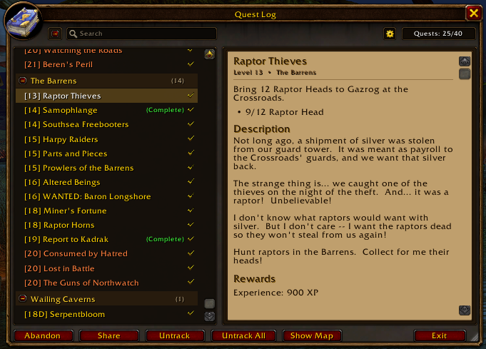
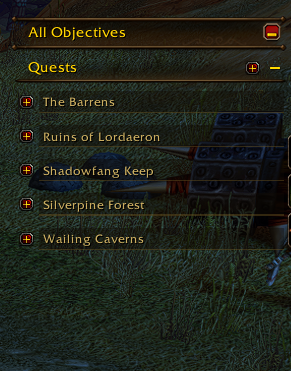
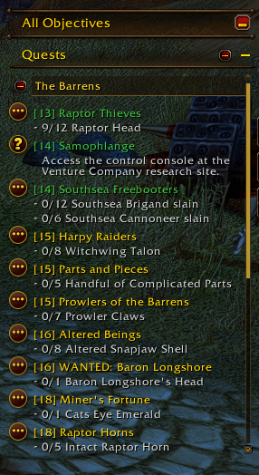
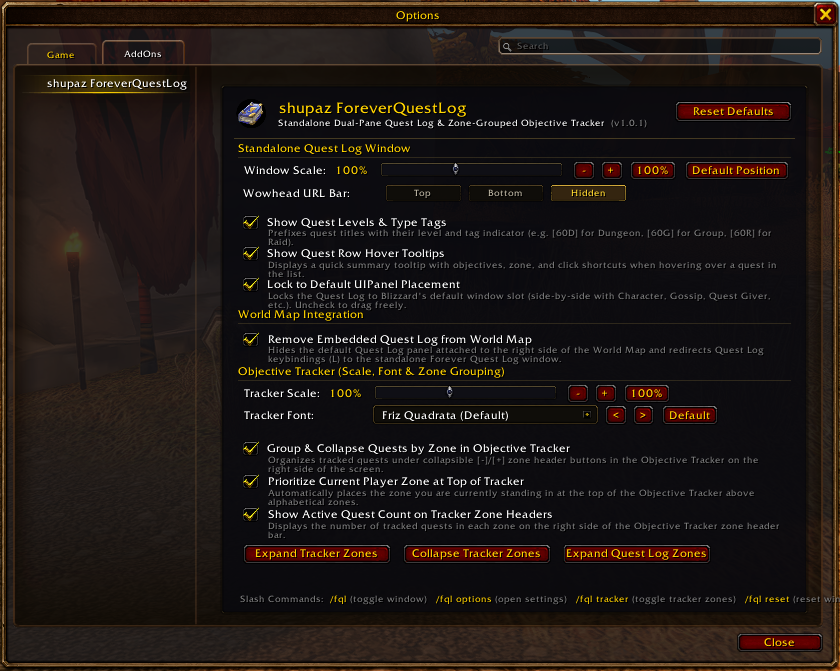

# shupaz ForeverQuestLog

<p align="center">
  
</p>

<p align="center">
  <a href="https://github.com/shupaz/Forever-Quest-Log/releases"></a>
  <a href="https://www.curseforge.com/wow/addons/shupaz-foreverquestlog"></a>
  <a href="https://addons.wago.io/addons/shupaz-foreverquestlog"></a>
  <a href="LICENSE"></a>
</p>

**shupaz ForeverQuestLog** is a lightweight, modular World of Warcraft addon designed for Classic and Forever clients. It restores the beloved standalone Classic dual-pane Quest Log window, completely decoupling it from the full-screen World Map while introducing modern conveniences like Wowhead quest link cards, real-time objective tracking, collapsible zone grouping in the Objective Tracker, and smooth custom scrolling.

---

## ✨ Features

### 📜 Classic Dual-Pane Quest Log
- **Standalone & Movable**: Sits cleanly on your screen without obstructing the World Map. Drag anywhere or let it intelligently dock side-by-side with Blizzard windows (Character Info, Spellbook, Professions, etc.).
- **Dual-Pane Layout**:
  - **Left Pane**: Collapsible zone headers with quest counts, colored difficulty levels (`[Level] Quest Title`), and completion statuses.
  - **Right Pane**: Rich quest descriptions, objectives, material requirements, XP, gold, and reward item previews.
- **Track All / Untrack All**: One-click button that dynamically tracks all active quests or clears all tracking.
- **Double-Click to Show Map**: Double-click any quest in the list to open the small (windowed) World Map directly to that quest's zone side-by-side with the Quest Log.
- **Shift-Click Abandon All**: Hold `Shift` and click **Abandon** to clear all quests in your Quest Log (with confirmation).
- **Wowhead Quest Link Integration**: Optional dockable Wowhead URL bar (**Top | Bottom | Hidden**, default **Hidden**), plus clickable quest title and right-click context menu linking directly to `wowhead.com/forever/quest=<id>`.
- **Full ESC Key & UIPanel Support**: Closes with `Escape`, docks side-by-side with narrow Blizzard panels (`CharacterFrame`, `GossipFrame`, `QuestFrame`, small `WorldMapFrame`), and auto-closes when full-screen panels open.
- **Quick Action Bar**: Dedicated buttons for **Track All**, **Abandon Quest**, **Share Quest**, and **Show on Map**.
- **Right-Click Context Menu**: Right-click any quest to track/untrack, super-track (map arrow), paste into chat, view Wowhead URL, share, or abandon.

---

### 🎯 Enhanced Objective Tracker
- **Zone Grouping**: Quests in your Blizzard Objective Tracker are automatically categorized under distinct, handsome Zone Headers.
- **Collapsible Sections**: Click any zone header to collapse or expand its quests on the fly.
- **Master Toggle**: One-click button on the Objective Tracker header to collapse or expand all tracked zones at once.
- **Current Zone Priority**: Automatically floats quests in your current zone to the very top of your tracker.
- **Progress Badges**: Zone headers display real-time completion status (e.g. `(3/5)`).
- **Instant Real-Time Updates**: Quest kills, item pickups, and criteria updates refresh the tracker immediately.
- **Smart Custom Scrollbar**: A sleek, non-intrusive scrollbar automatically appears whenever your tracked quests exceed screen bounds. Scroll smoothly using your mouse wheel or drag the scrollbar thumb.

---

### 🎨 Customization & Modern Integration
- **Custom Fonts**: Dynamically discovers all fonts active in your WoW client (`GetFonts()`) plus any fonts registered via **LibSharedMedia-3.0**, with mousewheel scrolling support.
- **Independent Scaling**: Configure Quest Log scale and Objective Tracker scale separately (60% to 160%).
- **World Map Decoupling**: Completely suppresses the embedded World Map quest panel and redirects the Micro Menu Quest button directly to the standalone Quest Log.
- **Minimap Addon Compartment**: Left-click to toggle the Quest Log, right-click to instantly open settings.
- **Configurable Keybinding**: Default bound to **L** (configurable in Game Options > Keybindings > AddOns).

---

## 📸 Screenshots

| Standalone Quest Log | Objective Tracker Grouping |
| :---: | :---: |
|  |  |

| Tracker Scrollbar | Settings Panel |
| :---: | :---: |
|  |  |

---

## ⌨️ Slash Commands

| Command | Description |
| :--- | :--- |
| `/fql` or `/questlog` | Toggle the standalone Quest Log window. |
| `/fql opt` or `/fql config` | Open the AddOn Settings panel. |
| `/fql tracker` | Toggle Objective Tracker zone grouping on or off. |
| `/fql reset` | Reset the Quest Log window position and scale back to defaults. |
| `/fql scale <number>` | Set window scale directly (e.g. `/fql scale 1.1`). |
| `/fql fixmenu` | Re-register Micro Menu button hooks if overridden by other addons. |

---

## ⚙️ Configuration & Options

Access the settings panel via:
- Game Menu (`ESC`) > **Options** > **AddOns** > **shupaz ForeverQuestLog**
- Or type `/fql opt` in chat.

### Settings Include:
- **Quest Log Window**:
  - Scale slider (60% to 160%).
  - Lock Window (prevent dragging).
  - Use Default Screen Position (auto-dock beside character/spellbook windows).
  - Show Quest Levels in quest list.
  - Show Detailed Tooltips on hover.
  - Suppress Embedded World Map Quest Log.
- **Objective Tracker**:
  - Group Tracked Quests by Zone.
  - Prioritize Current Zone (floats current zone to top).
  - Show Zone Quest Count Badges (`(x/y)`).
  - Objective Tracker Scale slider (60% to 160%).
  - Objective Tracker Font dropdown (10 built-in fonts + LibSharedMedia).

---

## 📦 Directory Structure & Architecture

```text
Forever-Quest-Log/
│
├── assets/
│   ├── logo.png
│   ├── screenshot_01.png
│   ├── screenshot_02.png
│   ├── screenshot_03.png
│   └── screenshot_05.png
│
├── src/
│   ├── Utils.lua           # Global namespace, DB defaults, helpers, dynamic fonts & Quest API wrappers
│   ├── Hooks.lua           # World Map quest suppression, CVars, keybindings & Micro Menu redirection
│   ├── QuestLog.lua        # Dual-pane Quest Log window, UIPanel placement, Wowhead bar & action buttons
│   ├── Tracker.lua         # Blizzard Objective Tracker zone grouping, collapsible headers & custom scrollbar
│   ├── Options.lua         # Settings panel in Game Options > AddOns, sliders, checkboxes & font dropdown
│   └── Init.lua            # Public API, Addon Compartment callbacks, event dispatcher & slash commands (/fql)
│
├── shupaz_ForeverQuestLog.toc # Addon manifest loading modules in strict dependency order
├── change-log.md           # Version release history
├── .pkgmeta                # BigWigs Packager configuration
├── LICENSE                 # MIT License
└── README.md               # Documentation
```

---

## 💻 Manual Installation

1. Download the latest release `.zip` from [Releases](https://github.com/shupaz/Forever-Quest-Log/releases), [CurseForge](https://www.curseforge.com/wow/addons/shupaz-foreverquestlog), or [Wago](https://addons.wago.io/addons/shupaz-foreverquestlog).
2. Extract the `shupaz_ForeverQuestLog` folder into your World of Warcraft AddOns directory:
   ```text
   World of Warcraft\_forever_\Interface\AddOns\
   ```
3. Ensure the folder structure appears as:
   ```text
   Interface\AddOns\shupaz_ForeverQuestLog\
       ├── shupaz_ForeverQuestLog.toc
       └── src\
           ├── Utils.lua
           ├── Hooks.lua
           ├── QuestLog.lua
           ├── Tracker.lua
           ├── Options.lua
           └── Init.lua
   ```
4. Start World of Warcraft and verify **shupaz ForeverQuestLog** is enabled in your AddOn list.

---

## 🤝 Acknowledgements

Developed by **shupaz**, built, refined, and modularized in pair programming with **Antigravity** (Google DeepMind).

---

## 📄 License

This project is licensed under the [MIT License](LICENSE).
